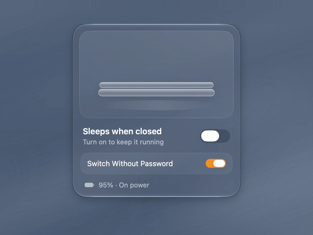
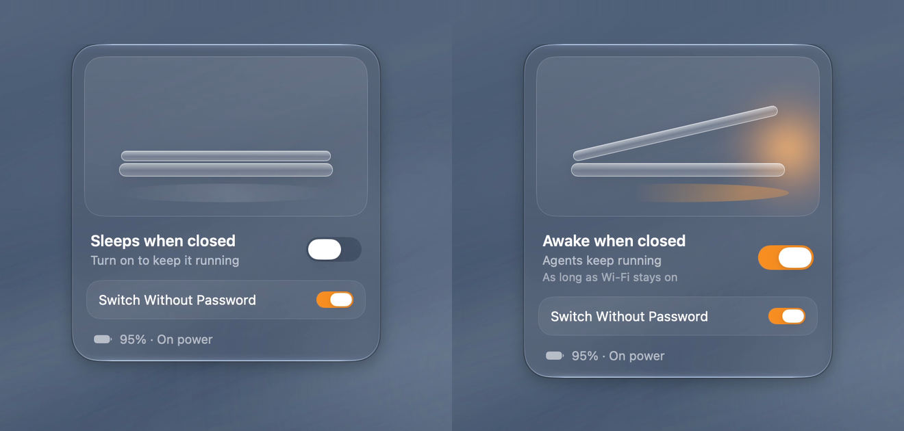

<div align="center">


# Sleepwalk · 梦游

**Close the lid. Keep it running.**<br>
**合上盖子，程序照跑。**

A menu-bar switch that keeps your MacBook awake with the lid closed. No external display.<br>
MacBook 菜单栏里的一个开关：合上盖子也不睡眠，不用外接显示器。

[](LICENSE)


**English** · [中文](README.zh-CN.md)



[Why](#why) · [Features](#features) · [Install](#install) · [FAQ](#faq) · [Uninstall](#uninstall)

</div>

## Why

A MacBook sleeps when you close the lid. Clamshell mode avoids this only with an external display, keyboard or mouse, and power connected.

`caffeinate` and most "keep awake" toggles stop **idle** sleep only. They do not stop **lid-close** sleep, so your agent, download or build stops when the lid goes down. `caffeinate -s` can help, but only on AC power.

Sleepwalk uses `pmset -a disablesleep 1`, an undocumented `pmset` option that stops lid-close sleep without an external display. It puts that setting behind one switch and always shows you its state. Similar tools exist, such as Amphetamine's closed-display mode. Sleepwalk is the small, open-source, one-switch version.

## Features



- **One switch.** Click the menu-bar icon to open the panel, click again to close it. The title tells you the state: **Sleeps when closed** or **Awake when closed**.
- **You can see it is on.** The menu-bar icon glows amber while it is on.
- **Battery reminder.** While it is on and you are on battery, the footer shows *Drains battery*.
- **Quit restores sleep.** Quit from the menu (right-click or Control-click the icon) and normal sleep comes back. If that fails, for example because you cancel the password prompt, Sleepwalk tells you and lets you stay open. To quit and keep it on, hold ⌥ in the menu: **Quit and Stay Awake**.
- **Reminds you after an unclean exit.** If Sleepwalk is force-quit, crashes, or you log out or shut down without Switch Without Password while it is on, the setting stays on. Sleepwalk remembers it turned it on and, the next time you open it, asks whether to restore normal sleep.
- **Optional: Switch Without Password.** Off by default, so each switch asks for your admin password. Turn it on to install a sudoers rule, for your user only, that allows exactly `pmset -a disablesleep 0` and `pmset -a disablesleep 1`. Turn it off to remove the rule.
- **Small and local.** One Swift file. No network access, no analytics, no privileged helper or daemon.
- **English and Chinese**, following your system language.

While it is on, the Mac does not sleep at all: not when you close the lid, not when it is idle, not from the Apple menu.

## Install

You need a MacBook with macOS 13 or later, and a Swift compiler. The Xcode Command Line Tools are enough:

```bash
xcode-select --install
```

Then build and install:

```bash
git clone https://github.com/Cherrie-on-the-top/Sleepwalk.git
cd Sleepwalk
./install.sh
```

The script builds a universal app (Apple silicon and Intel) from source, installs it to `~/Applications/Sleepwalk.app`, and opens it. It takes about a minute. If Xcode is selected but its license was never accepted, the script uses the Command Line Tools instead.

To start Sleepwalk at login, add it in System Settings → General → Login Items.

## FAQ

**Is this the same as `caffeinate` or "Keep computer awake"?**<br>
No. Those stop idle sleep. `caffeinate -s` also stops system sleep, but only on AC power. Sleepwalk changes the system setting that lid-close sleep checks.

**Does the screen stay on with the lid closed?**<br>
No. The display turns off as usual. Only the system stays awake.

**Will my agent keep working with the lid closed?**<br>
Only while it can reach the network. Sleepwalk keeps the Mac awake; it does not keep it online. An agent that calls a cloud model stops when Wi-Fi drops, for example when you carry the closed MacBook out of range.

**What if I forget it is on?**<br>
The menu-bar icon glows amber while it is on. Quitting from the menu turns normal sleep back on. To check from Terminal: `pmset -g | grep SleepDisabled` (`1` = stays awake).

**Does the setting survive a restart?**<br>
Yes. It is a system setting, not part of the app. It stays on after a restart, after a force quit, or if you log out while Sleepwalk is on and Switch Without Password is off (macOS can't show a password prompt then). To turn it off without the app: `sudo pmset -a disablesleep 0`.

**What happens when the battery runs low?**<br>
Not tested. With sleep disabled, the Mac may not go into safe sleep and can shut down when the battery is empty. Save your work, or plug in for long jobs.

**Can I put it in my bag while it runs?**<br>
You can, but the Mac does not sleep at all. Heavy work in a closed bag gets hot, and the battery keeps draining.

**Why does it ask for my password?**<br>
`pmset` needs administrator rights. If you don't want to type it every time, turn on Switch Without Password. Note that with the rule on, any app running as you can also turn sleep on or off without asking.

**Why is there no download?**<br>
Sleepwalk is not signed with an Apple Developer ID. An app you build on your own Mac opens without Gatekeeper warnings, and you run exactly the code you can read.

## Uninstall

```bash
./uninstall.sh
```

The script restores normal sleep, removes your sudoers rule if it exists, and moves the app to the Trash. It asks for your password.

## Tested on

macOS 27.2, Apple silicon. The code also compiles against the macOS 15 SDK for Apple silicon and Intel, but it has not been tested on real macOS 13–15 machines or Intel Macs. Reports are welcome in [Issues](https://github.com/Cherrie-on-the-top/Sleepwalk/issues).

## License

[MIT](LICENSE) © 2026 Haoli. Designed and made by Haoli.

You can use, change and share it. Keep the copyright and license notice in copies and forks.

<sub>Demo background: procedural still water inspired by ambi.ai, rebuilt from scratch. Not affiliated with ambi.ai; no ambi assets are used.</sub>
