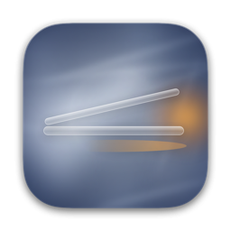
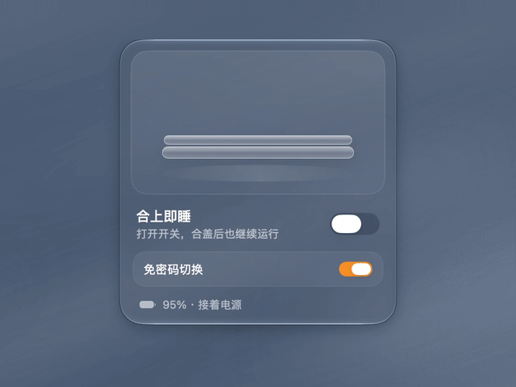
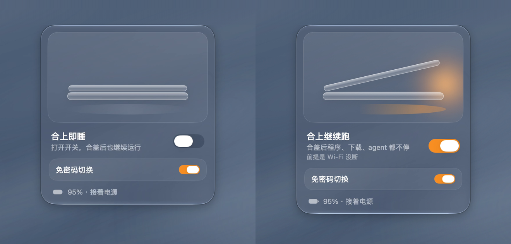

<div align="center">



# 梦游 · Sleepwalk

**合上盖子，程序照跑。**<br>
**Close the lid. Keep it running.**

MacBook 菜单栏里的一个开关：合上盖子也不睡眠，不用外接显示器。<br>
A menu-bar switch that keeps your MacBook awake with the lid closed. No external display.

[](LICENSE)


[English](README.md) · **中文**



[为什么需要](#为什么需要它) · [功能](#功能) · [安装](#安装) · [常见问题](#常见问题) · [卸载](#卸载)

</div>

## 为什么需要它

MacBook 合盖就睡眠。只有接了外接显示器、键盘或鼠标、电源（合盖模式），才能合着盖子继续用。

`caffeinate` 和多数“保持唤醒”开关只阻止**闲置睡眠**，挡不住**合盖睡眠**。盖子一合，agent、下载、编译就停了。`caffeinate -s` 有帮助，但只在接着电源时有效。

梦游用的是 `pmset -a disablesleep 1`。这是 `pmset` 没有写进文档的选项，不接外接显示器也能挡住合盖睡眠。梦游把它做成一个开关，并让你随时看到当前状态。类似的工具也有，比如 Amphetamine 的合盖模式。梦游是小巧、开源、只有一个开关的版本。

## 功能



- **一个开关。** 点菜单栏图标弹出面板，再点一下收起。标题直接告诉你状态：**合上即睡** 或 **合上继续跑**。
- **开着一眼就知道。** 打开时，菜单栏图标亮起琥珀色。
- **电量提醒。** 开着并且用电池时，底栏显示“仍在耗电”。
- **退出即恢复睡眠。** 从菜单退出（右键或 Control-点按图标），正常睡眠就回来了。如果没能恢复，比如你取消了密码框，梦游会告诉你，并让你选择不退出。想退出但保持醒着：在菜单里按住 ⌥，选“退出并保持醒着”。
- **没正常退出也会提醒。** 梦游开着时如果被强制退出、崩溃，或者没开免密码切换就注销、关机，设置会一直留着。梦游记得是自己打开的，下次你打开它时会问你要不要恢复正常睡眠。
- **可选：免密码切换。** 默认关闭，每次切换都要输管理员密码。打开后会为当前用户装一条 sudoers 规则，只允许免密执行 `pmset -a disablesleep 0` 和 `pmset -a disablesleep 1`。关闭就删除这条规则。
- **小，且只在本机。** 只有一个 Swift 文件。不联网，不做统计，没有特权辅助程序或后台守护进程。
- **中文和英文**，跟随系统语言。

打开时，Mac 完全不睡眠：合盖不睡，闲置不睡，从苹果菜单选“睡眠”也不睡。

## 安装

需要 macOS 13 或更高的 MacBook，以及 Swift 编译器。装 Xcode 命令行工具就够了：

```bash
xcode-select --install
```

然后编译并安装：

```bash
git clone https://github.com/Cherrie-on-the-top/Sleepwalk.git
cd Sleepwalk
./install.sh
```

脚本会从源码编译通用版 app（Apple 芯片和 Intel 都能用），装到 `~/Applications/Sleepwalk.app` 并打开。大约需要一分钟。如果系统选中的是 Xcode，但从没同意过它的许可协议，脚本会改用命令行工具。

想开机自动启动：在 系统设置 → 通用 → 登录项 里添加。

## 常见问题

**它和 `caffeinate`、“保持计算机唤醒”一样吗？**<br>
不一样。那些只挡闲置睡眠。`caffeinate -s` 也能挡系统睡眠，但只在接着电源时有效。梦游改的是合盖睡眠要检查的那个系统设置。

**合上盖子后屏幕会一直亮吗？**<br>
不会。屏幕照常熄灭，只有系统保持运行。

**合盖后 agent 一定能继续跑吗？**<br>
前提是网络没断。梦游只让 Mac 保持醒着，不负责联网。调用云端模型的 agent，Wi-Fi 一断就会停，比如合着盖子把 MacBook 带出 Wi-Fi 范围。

**忘了关怎么办？**<br>
打开时菜单栏图标会亮琥珀色。从菜单退出就会恢复正常睡眠。也可以在终端查看：`pmset -g | grep SleepDisabled`（`1` 表示保持醒着）。

**重启后设置还在吗？**<br>
在。这是系统设置，不属于 app。重启、强制退出之后它都还开着；在梦游开着、免密码切换关着的时候注销，也会这样（注销途中 macOS 没法弹密码框）。不用 app 关掉它：`sudo pmset -a disablesleep 0`。

**电量快用完时会怎样？**<br>
没有测试过。睡眠被禁用时，Mac 可能来不及进入安全睡眠，电池耗尽就直接关机。请先保存工作，长时间任务接上电源。

**开着能放进包里吗？**<br>
能，但 Mac 完全不睡眠。在包里跑重活会发热，电池也会一直耗。

**为什么要输密码？**<br>
`pmset` 需要管理员权限。不想每次都输，就打开“免密码切换”。注意：打开后，任何以你的身份运行的 app 也能不经询问地开关睡眠。

**为什么没有直接下载的安装包？**<br>
梦游没有用 Apple 开发者证书签名。在你自己的 Mac 上编译的 app 打开时不会有 Gatekeeper 警告，你运行的也正是你能看到的代码。

## 卸载

```bash
./uninstall.sh
```

脚本会恢复正常睡眠，删除你的 sudoers 规则（如果装过），并把 app 移到废纸篓。需要输入密码。

## 测试情况

已在 macOS 27.2（Apple 芯片）上测试。代码也能用 macOS 15 SDK 为 Apple 芯片和 Intel 编译通过，但还没有在 macOS 13–15 真机和 Intel Mac 上测过，欢迎在 [Issues](https://github.com/Cherrie-on-the-top/Sleepwalk/issues) 反馈。

## 许可证

[MIT](LICENSE) © 2026 Haoli。Haoli 设计与制作。

可以自由使用、修改和分享。复制或 fork 时请保留版权声明和许可声明。

<sub>演示背景：程序生成的静水底色，灵感来自 ambi.ai，从零重写。与 ambi.ai 无关联，没有使用 ambi 的素材。</sub>
